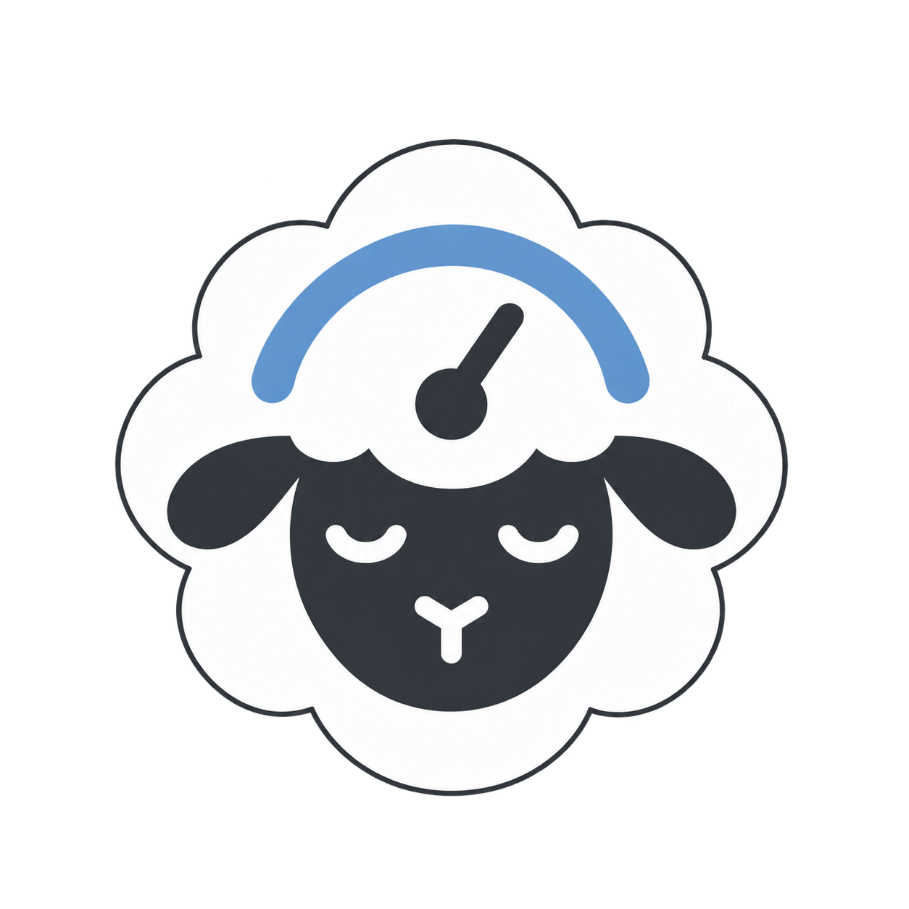
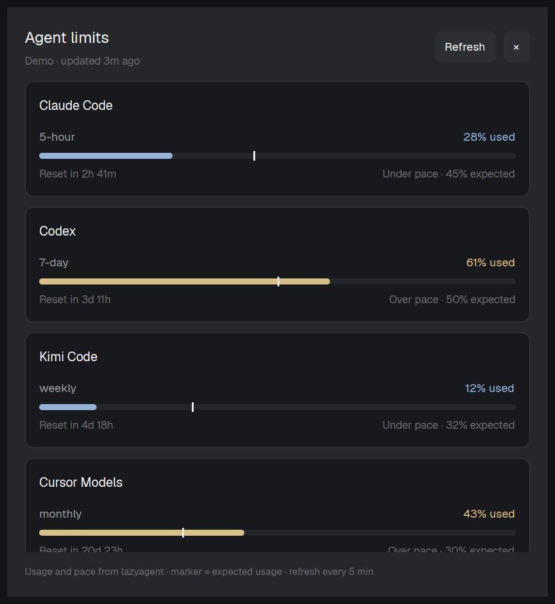

<p align="center">
  <picture>
    <source media="(prefers-color-scheme: dark)" srcset="assets/icon-transparent-dark.png">
    <source media="(prefers-color-scheme: light)" srcset="assets/icon-transparent-light.png">
    
  </picture>
</p>

<h1 align="center">Herdr Lazyagent</h1>

<p align="center">
  <em>Your coding agent rate limits, inside Herdr.</em>
</p>

<p align="center">
  <a href="https://github.com/illegalstudio/herdr-lazyagent/stargazers"></a>
  <a href="LICENSE"></a>
  <a href="https://herdr.dev"></a>
  <a href="https://github.com/illegalstudio/lazyagent"></a>
</p>

<p align="center">
  <strong>Usage vs expected &middot; Pace indicators &middot; Reset countdowns &middot; Native Herdr UI</strong>
</p>

<p align="center">
  A native <a href="https://herdr.dev">Herdr</a> mod powered by <a href="https://github.com/illegalstudio/lazyagent">lazyagent</a>.
  Keep the most consumed window in your status bar, then open the panel for usage, pace and resets across Claude Code, Codex, Grok, Kimi Code and Cursor, when available.
</p>

<p align="center">
  <a href="https://illegal.studio/en/products/herdr-lazyagent"><strong>Official Website</strong></a>
</p>

---

<p align="center">
  
</p>

## Requirements

- The **new Herdr desktop app**, with JavaScript / gpui-kit mods. This is not
  a plugin for the legacy Herdr TUI.
- [lazyagent](https://github.com/illegalstudio/lazyagent#install) **0.15 or newer**,
  installed separately and available on `PATH` or in a standard binary location.
- Python **3.10 or newer**, with no additional packages.
- Linux or macOS, with the providers you want to monitor already signed in.

Verify the backend first:

```sh
lazyagent --version
lazyagent limits --json
```

## Install with your agent

Give your agent this prompt:

> Read ~/.config/herdr-app/AGENTS.md, then install the mod from
> https://github.com/illegalstudio/herdr-lazyagent. Read RECIPE.md and the
> source files first. Add the compact indicator on the right of my status
> bar, preserving my current layout. Clone the layout first if it is shipped
> by Herdr. This mod runs Python and lazyagent, reads local usage caches and
> queries providers through lazyagent when the cache needs refreshing.

The package follows Herdr's shared-mod layout: `mods/herdr-lazyagent/` plus
`RECIPE.md` and `preview.png`. It does not install or update lazyagent.

## Manual install

Clone the repository and copy the mod into Herdr's home. The command refuses
to overwrite an existing installation:

```sh
git clone https://github.com/illegalstudio/herdr-lazyagent.git
cd herdr-lazyagent
python3 - <<'PY'
from pathlib import Path
import os
import shutil

home = Path(os.environ.get("HERDR_APP_HOME") or Path.home() / ".config/herdr-app")
shutil.copytree("mods/herdr-lazyagent", home / "mods/herdr-lazyagent")
PY
herdr-app check ~/.config/herdr-app/mods/herdr-lazyagent
```

`mod.json` uses `"place": "none"`, so copying the files does not rearrange
your window. Add a block to a **personal layout**, for example as the last
child of a horizontal status row:

```json
{
  "id": "lazyagent-limits",
  "type": "block",
  "size": { "px": 220 },
  "content": { "mod": "herdr-lazyagent" }
}
```

Keep the row around 28 px high and the existing status block flexible. If
you use a shipped layout, clone it before changing its structure:

```sh
herdr-app do layout.clone '{"name":"main","as":"my-layout"}'
```

Herdr reloads the files automatically. For a custom `HERDR_APP_HOME`, use
that folder in the check command too. Once the indicator is loaded, open
the panel from the CLI with:

```sh
herdr-app do herdr-lazyagent.open
```

## Using the panel

- Click **Limits** in the status bar to open the centered panel.
- Each available provider window shows its used percentage and a marker for
  expected usage at a linear pace. The label says under, on or over pace.
- **Refresh** requests new data, while respecting provider backoff.
- Reset countdowns update locally every 30 seconds. Scroll to see more providers.
- Close with **×** or **Escape**.

If lazyagent is not found, the panel explains the requirement and provides
an **Installation instructions on GitHub** button. It opens lazyagent's
installation guide in your browser. Install the command so it is available
on your `PATH`, then click **Refresh**; no Herdr restart is needed.

The numbers belong to the computer running the Herdr app. Selecting a
remote Herdr space does not switch the query machine. Missing windows stay
absent; the mod does not estimate limits the provider did not return.

## Cache and refresh behavior

The indicator checks every **five minutes**. Opening the panel accepts data
up to five minutes old. The adapter reads an existing
[omarchy-lazyagent](https://github.com/illegalstudio/omarchy-lazyagent) cache
when available, so the two frontends can reuse recent snapshots. Omarchy is
optional and its state is never modified.

Provider rate limits trigger exponential backoff, starting at two minutes
and capped at 30 minutes. Last successful provider reports remain visible
as **Stale data** when a later query fails. Even manual refresh respects an
active provider backoff.

| State | Default location |
| --- | --- |
| Herdr cache and refresh lock | `~/.local/state/herdr-lazyagent/` |
| Optional Omarchy cache, read-only | `~/.local/state/omarchy-lazyagent/limits.json` |

Both follow `XDG_STATE_HOME` when set. A nonblocking file lock prevents
concurrent Herdr refreshes. It does not lock an unrelated Omarchy process,
so simultaneous refreshes across the two apps can still occur.

The adapter gives lazyagent **22 seconds** per query, fitting inside Herdr's
30-second command budget. It starts programs with argument arrays, uses no
shell interpolation, and stores usage snapshots rather than credentials.
lazyagent handles provider authentication. Its usage endpoints are
undocumented and can change upstream.

## Development

The mod UI is JavaScript using Herdr's native gpui-kit. The Python adapter
uses the standard library and an MIT bridge from omarchy-lazyagent.

```sh
herdr-app check mods/herdr-lazyagent
python3 -B -m unittest discover -s tests -v
```

After changing the UI, also try it in Herdr: the check command covers only
the initial render, not later async data or the opened dialog. See
[RECIPE.md](RECIPE.md) for composition and acceptance checks.

## Remove

Remove the `herdr-lazyagent` block from your personal layout, then remove
the mod's own folder under `mods/`. Keep any unrelated layout changes.
Removing this mod does not uninstall lazyagent or change provider logins.

## License

[MIT](LICENSE). The vendored bridge comes from
[omarchy-lazyagent](https://github.com/illegalstudio/omarchy-lazyagent/blob/main/scripts/lazyagent_bridge.py),
blob `0c1fa2f46cd8592807ef6cd251d4ac3e41288ac9`, copyright 2026 illegalstudio.
