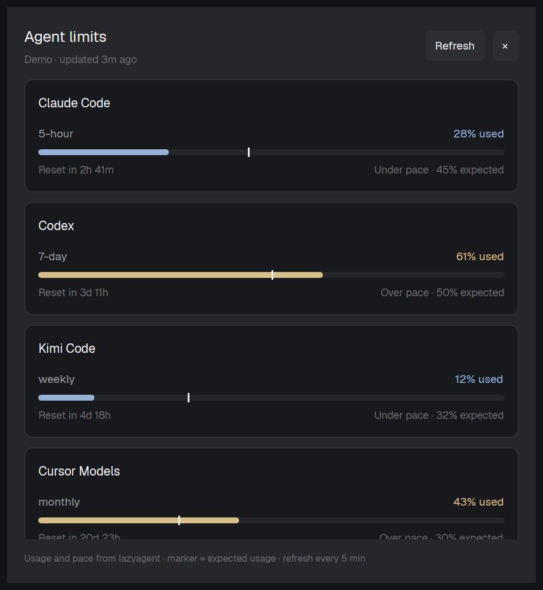

# Herdr Lazyagent

A native usage indicator for Herdr. A small status-bar block shows the
highest used quota across available providers; clicking opens a centered
scrollable panel with their windows, expected pace and reset countdowns.

## What you see

The compact block is about 220 by 28 logical pixels, placed at the right
of the user's status bar. It has a small status dot, **Limits**, the maximum
used percentage and a refresh or open glyph. It follows the Herdr theme.

The 560 by 610 panel has a heading, local machine label, age, **Refresh**
and **×**. Provider cards show the name, window label, used percentage,
horizontal usage bar and expected-usage marker. Each bar has a reset
countdown and pace label underneath. Cards scroll above a short footer.
High usage, over-pace consumption, stale reports and provider errors are
highlighted using theme colors.

## How it behaves

The compact block polls every five minutes. Opening the panel uses the
same cache age. Refresh requests a fresh report but does not bypass an
active provider backoff. The panel's countdown ticks every 30 seconds
without a network call. Escape and × close it. Errors leave usable earlier
data visible. Missing provider windows are not synthesized.

Agent working, blocked, idle and done states do not affect quota readings;
these are account usage windows, not per-terminal budgets. Remote space
selection does not change the local query machine. The preview uses
illustrative data rather than a personal account snapshot.

## Built from

- `mods/herdr-lazyagent/main.js` exports a gpui-kit `View`, using
  `h_flex`, `v_flex`, themed elements, `exec`, shared state, `openOverlay`,
  `closeOverlay` and `nextCommand`.
- One copy in the layout is the compact indicator. The dialog opens the
  same mod with `{ "role": "panel" }`. The CLI command
  `herdr-lazyagent.open` is handled by the loaded compact copy.
- `mod.json` uses `place: none`. Add the compact block to a personal layout;
  clone a shipped layout first. Do not replace the user's whole layout.
- `snapshot.py` calls the local `lazyagent limits --json` through Python,
  with 22 seconds available for the provider query. It uses `fcntl` to lock
  Herdr refreshes, reads optional Omarchy state and writes separate Herdr
  state under `XDG_STATE_HOME` or `~/.local/state`.
- `bridge.py` is the attributed MIT bridge from omarchy-lazyagent. It
  sanitizes the report, caches snapshots, tracks backoff and retains stale
  per-provider data. No Omarchy installation or HTTP server is required.

Before installing, disclose that this mod runs Python and lazyagent, reads
local usage caches, writes its own cache, and accesses provider usage
endpoints through lazyagent. It does not read credentials itself.

## Watch out

Herdr's `exec` has a 30-second budget; keep the provider deadline at 22
seconds and avoid extra discovery subprocesses. Python 3.10+ and local
lazyagent are required. Windows is unsupported because of `fcntl`.

Popups at a bottom-edge pointer may have very little vertical room; use
the centered dialog. `nextCommand()` returns a string. Theme-generated
type files and `jsconfig.json` are not source files to publish.

The Herdr lock cannot coordinate an unchanged Omarchy frontend. Reusing a
fresh cache reduces duplicate queries, but simultaneous cross-app refreshes
remain possible. This version has fixed refresh intervals and shows all
providers supported by lazyagent; it has no settings panel or remote mode.

## Done when

- `herdr-app check mods/herdr-lazyagent` passes.
- Focused Python tests pass without credentials or provider calls.
- A compact copy fits beside the existing status content in a personal layout.
- Clicking it opens the scrollable centered panel with real available data.
- Used bars and expected markers stay inside their tracks; reset labels
  count down, and unavailable windows remain absent.
- Refresh, Escape and × work, and `herdr-app status` reports no mod errors.
- A failed provider is shown with its error and any cached report marked stale.
- Provider backoff is retained, optional Omarchy state stays unchanged,
  and the active remote space does not relabel local account data.
